<div align="center">
  
</div>

<p align="center">
  <b>Aaroh Nanoti</b> · Computer Science @ UT Dallas · 🏆 5× hackathon winner<br/>
  I build systems that perceive, decide, and move: autonomous vehicles, medical-imaging ML, and LLM agents.
</p>

<br/>



I'm a computer science student at UT Dallas. I like problems where software has to deal with the real world: a car that has to see the track, a scan a clinician has to trust, an assistant that has to actually get the thing done.

- 🏁 **Hackathons**: 5 wins across Hack AI, Axxess, HackUTD, and FinHack
- 🏎️ **Autonomous vehicles and ADAS**: ROS 2, F1TENTH racing, dSPACE ASM simulation
- 🩻 **Medical-imaging ML** that reports its own limits: confidence intervals, leakage audits, abstention
- 🧠 **LLM agents** with tool calling and voice interfaces
- ⚡ **Energy systems**: LSTM demand forecasting

<sub>Fun fact: I debug code faster than I debug my life.</sub>

<br clear="both"/>



| | Award | Hackathon | Project |
| :-: | :-- | :-- | :-- |
| 🏆 | **Winner**, Dallas AI sponsor track | Hack AI 2026 | [Pondr](https://devpost.com/software/cortex-23qedp) |
| 🏆 | **Winner**, AI-Driven Preventative Health Partner | Axxess Hackathon 2026 | [MaternalGuard](https://devpost.com/software/xxx-spie1l) |
| 🏆 | **Winner**, T-Mobile challenge | HackUTD 2025 | [HarmoniQ](https://devpost.com/software/x-yiqm81) |
| 🏆 | **Winner**, Best Use of Auth0 | HackUTD 2025 | [HarmoniQ](https://devpost.com/software/x-yiqm81) |
| 🏆 | **Winner** | FinHack 2025 | [QUADA](https://github.com/aarohCodes/Robo-Advisory-Portfolio-Optimizer) |

<table>
<tr>
<td width="50%" valign="top">
<a href="https://devpost.com/software/cortex-23qedp"></a>
<b><a href="https://devpost.com/software/cortex-23qedp">Pondr</a></b> 🏆<br/>
Turns what you're learning into a living knowledge graph. An XGBoost model personalises the Ebbinghaus forgetting curve for each concept to predict what you're about to forget, and a Gemini tutor explains, quizzes, and schedules the review before it slips. Built with a team of four.<br/>
<sub><code>FastAPI</code> <code>XGBoost</code> <code>Gemini</code> <code>MongoDB</code> <code>React Flow</code> <code>ElevenLabs</code> · <a href="https://github.com/aarohCodes/HackAI2026">code</a></sub>
</td>
<td width="50%" valign="top">
<a href="https://devpost.com/software/xxx-spie1l">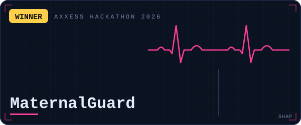</a>
<b><a href="https://devpost.com/software/xxx-spie1l">MaternalGuard</a></b> 🏆<br/>
Clinical decision support for the weeks after birth. Predicts risk for five postpartum complications and explains every prediction with SHAP values a clinician can read. Trained on synthetic data; a prototype, not a medical device.<br/>
<sub><code>XGBoost</code> <code>SHAP</code> <code>FastAPI</code> <code>Next.js</code> <code>Tailwind</code> · <a href="https://github.com/aarohCodes/AxxessHackathon2026">code</a></sub>
</td>
</tr>
<tr>
<td width="50%" valign="top">
<a href="https://devpost.com/software/x-yiqm81">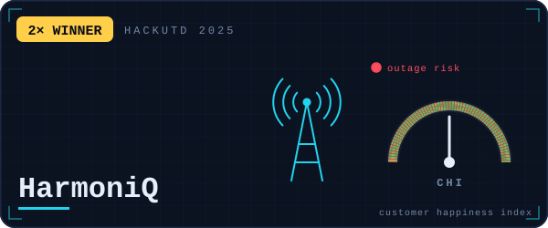</a>
<b><a href="https://devpost.com/software/x-yiqm81">HarmoniQ</a></b> 🏆🏆<br/>
A command center that ties network health to how customers feel. Combines network performance data with live Reddit and X sentiment, predicts regional outages with Random Forest and gradient boosting, and rolls it all into a Customer Happiness Index, with a Gemini assistant explaining what changed. Built with a team of four.<br/>
<sub><code>React</code> <code>Flask</code> <code>scikit-learn</code> <code>Gemini</code> <code>Auth0</code> <code>Tailwind</code> · <a href="https://github.com/aarohCodes/HarmoniQ-T-Mobile-Challenge">code</a></sub>
</td>
<td width="50%" valign="top">
<a href="https://github.com/aarohCodes/Robo-Advisory-Portfolio-Optimizer"></a>
<b><a href="https://github.com/aarohCodes/Robo-Advisory-Portfolio-Optimizer">QUADA</a></b> 🏆<br/>
Robo-advisor that builds ESG-aware portfolios across risk profiles and pairs them with a Gemini-powered investment chat.<br/>
<sub><code>React</code> <code>Flask</code> <code>Gemini</code> <code>Tailwind</code> <code>Google OAuth</code></sub>
</td>
</tr>
</table>


<table>
<tr>
<td width="50%" valign="top">
<a href="https://github.com/aarohCodes/rsna-knee-abnormality-detection"></a>
<b><a href="https://github.com/aarohCodes/rsna-knee-abnormality-detection">RSNA Knee Abnormality Detection</a></b><br/>
RSNA's Kaggle code competition: predict 12 knee abnormalities per MRI study, from ACL and meniscus tears to effusion and fractures. Labels expanded from multilingual radiology reports, multi-slice models, and a rank-mean ensemble blended on a clean holdout, all inside a 9-hour offline kernel. 0.938 macro-AUC on the public leaderboard.<br/>
<sub><code>PyTorch</code> <code>DICOM</code> <code>ensembling</code> <code>Kaggle Kernels</code></sub>
</td>
<td width="50%" valign="top">
<a href="https://github.com/aarohCodes/AI-Driven-Energy-Advisory-and-LSTM-Prediction-Platform"></a>
<b><a href="https://github.com/aarohCodes/AI-Driven-Energy-Advisory-and-LSTM-Prediction-Platform">Arkos</a></b><br/>
AI energy advisory platform with LSTM demand forecasting, built with a team at Hack AI 2025. It analyses consumption patterns, forecasts demand, and recommends where to save. 15% improvement in energy efficiency.<br/>
<sub><code>TensorFlow</code> <code>LSTM</code> <code>Python</code></sub>
</td>
</tr>
<tr>
<td width="50%" valign="top">
<a href="https://github.com/aarohCodes/OvaScope_Meta_2026"></a>
<b><a href="https://github.com/aarohCodes/OvaScope_Meta_2026">OvaScope</a></b><br/>
Ovarian ultrasound analysis with inspectable evidence. Asks whether lesion localisation (a DINOv2 patch localiser prompting SAM 2.1) beats whole-image classification on eight MMOTU categories, then reports what the data says: bootstrap confidence intervals, a near-duplicate leakage audit, and an abstain path. Research prototype, not a diagnostic.<br/>
<sub><code>PyTorch</code> <code>DINOv2</code> <code>SAM 2.1</code> <code>FastAPI</code> <code>Next.js</code> <code>Docker</code></sub>
</td>
<td width="50%" valign="top">
<a href="https://github.com/aarohCodes/Jarvis">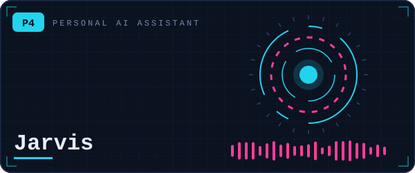</a>
<b><a href="https://github.com/aarohCodes/Jarvis">Jarvis</a></b><br/>
A personal assistant for student life. An LLM with tool calling sits on top of my Canvas calendar, course schedule, syllabi, tasks and weather, builds a morning briefing, and pushes reminders to my phone. Web and mobile clients.<br/>
<sub><code>FastAPI</code> <code>PostgreSQL</code> <code>Redis</code> <code>Next.js</code> <code>React Native</code> <code>Docker</code></sub>
</td>
</tr>
<tr>
<td width="50%" valign="top">
<a href="https://github.com/aarohCodes/F1Tenth-Autonomous-Division">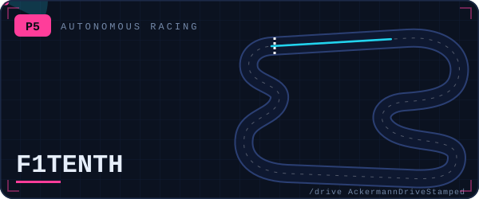</a>
<b><a href="https://github.com/aarohCodes/F1Tenth-Autonomous-Division">F1TENTH Autonomous Division</a></b><br/>
ROS 2 workspace for the F1TENTH 1/10-scale autonomous racing platform: Ackermann drive publisher and relay nodes with launch files, run against the F1TENTH gym simulator. The start of the racing stack.<br/>
<sub><code>ROS 2</code> <code>rclpy</code> <code>Ackermann</code> <code>f1tenth_gym_ros</code></sub>
</td>
<td width="50%" valign="top">
<a href="https://github.com/aarohCodes/CodeRed"></a>
<b><a href="https://github.com/aarohCodes/CodeRed">CodeRed</a></b><br/>
Voice-first kitchen assistant. Say the wake word, ask what's in the pantry, or scan groceries with the camera to add them to the inventory.<br/>
<sub><code>Python</code> <code>Gemini</code> <code>ElevenLabs</code> <code>JavaScript</code></sub>
</td>
</tr>
</table>

<sub>Also in the garage: <a href="https://github.com/aarohCodes/FlowCraft">FlowCraft</a>, an AI productivity suite for tasks, flashcards, email triage and meeting transcripts (React, TypeScript, Supabase).</sub>


| Subsystem | Components |
| :-- | :-- |
| **Engine** <br/><sub>languages</sub> | <kbd>Python</kbd> <kbd>TypeScript</kbd> <kbd>JavaScript</kbd> <kbd>C++</kbd> <kbd>Java</kbd> <kbd>SQL</kbd> |
| **Perception** <br/><sub>ML</sub> | <kbd>PyTorch</kbd> <kbd>TensorFlow</kbd> <kbd>scikit-learn</kbd> <kbd>XGBoost</kbd> <kbd>SHAP</kbd> <kbd>DINOv2</kbd> <kbd>SAM 2.1</kbd> <kbd>pandas</kbd> <kbd>NumPy</kbd> |
| **Driver aids** <br/><sub>LLMs and voice</sub> | <kbd>Claude API</kbd> <kbd>Gemini API</kbd> <kbd>OpenAI API</kbd> <kbd>tool calling</kbd> <kbd>ElevenLabs</kbd> |
| **Chassis** <br/><sub>full stack</sub> | <kbd>FastAPI</kbd> <kbd>Flask</kbd> <kbd>Next.js</kbd> <kbd>React</kbd> <kbd>React Native</kbd> <kbd>Tailwind</kbd> <kbd>Auth0</kbd> |
| **Fuel system** <br/><sub>data and infra</sub> | <kbd>PostgreSQL</kbd> <kbd>MongoDB</kbd> <kbd>Redis</kbd> <kbd>Supabase</kbd> <kbd>Docker</kbd> <kbd>Git</kbd> |
| **Track tools** <br/><sub>robotics and sim</sub> | <kbd>ROS 2</kbd> <kbd>F1TENTH gym</kbd> <kbd>dSPACE ASM</kbd> |


<p align="center">
  Building something in autonomy, medical AI, or agents? The radio is on.
</p>

<p align="center">
  <a href="mailto:aarohnanoti@gmail.com"></a>
  &nbsp;
  <a href="https://github.com/aarohCodes?tab=repositories"></a>
</p>

<details>
<summary>📻 Radio transcript</summary>
<br/>

```
ENGINEER  Box, box. The tests are failing.
AAROH     Copy. It works on my machine.
ENGINEER  We are checking.
AAROH     Leave me alone, I know what I'm doing.
ENGINEER  ...CI is green. Push, push.
```

</details>

<br/>

